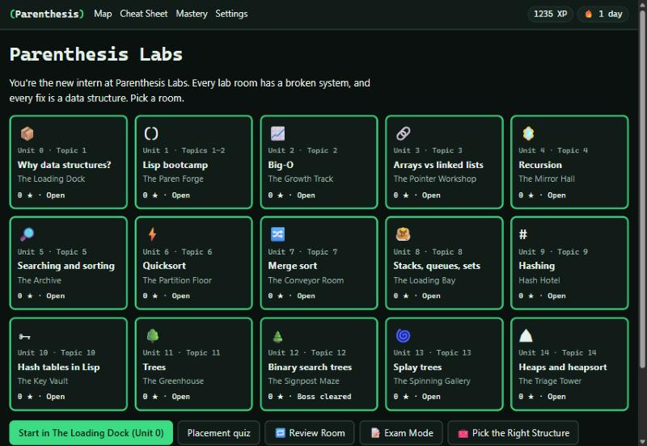
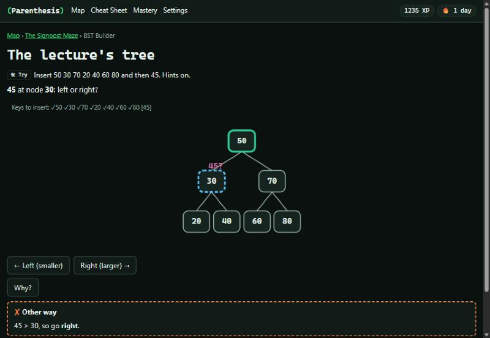
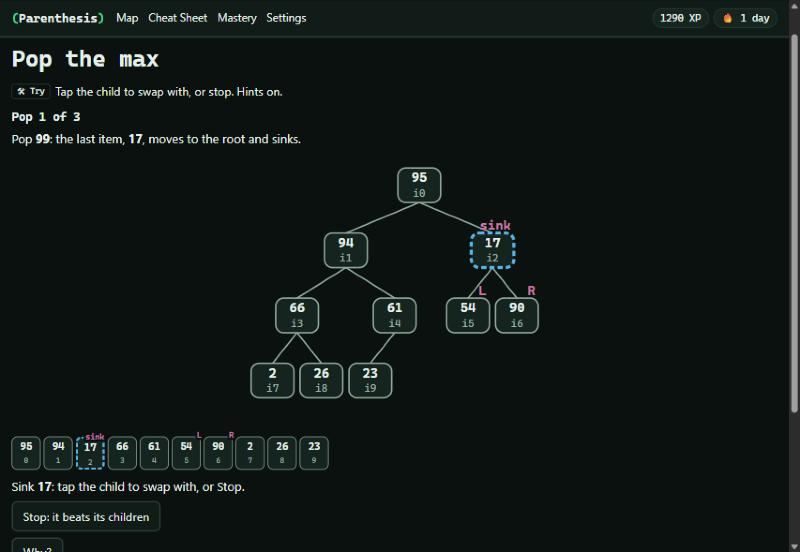
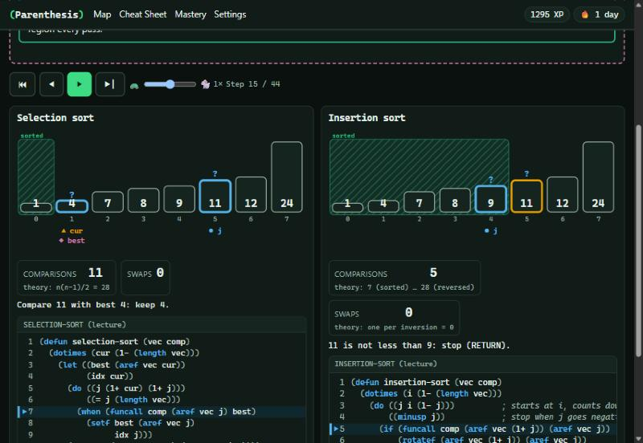
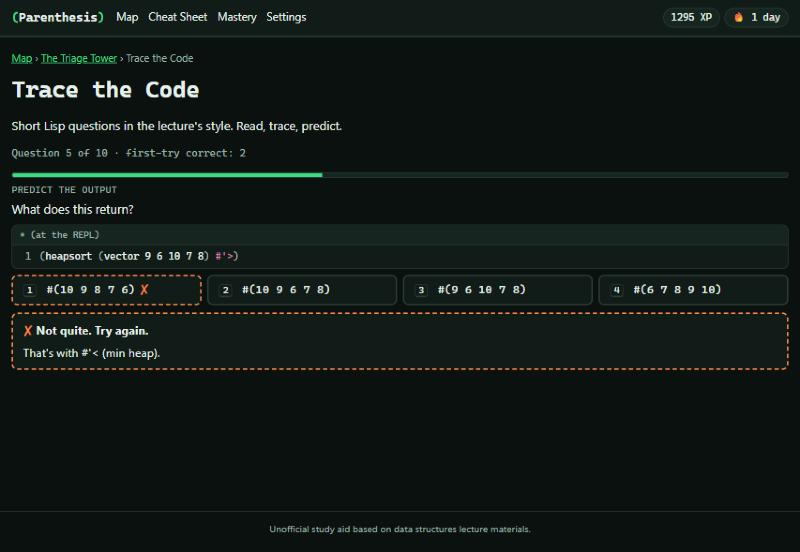
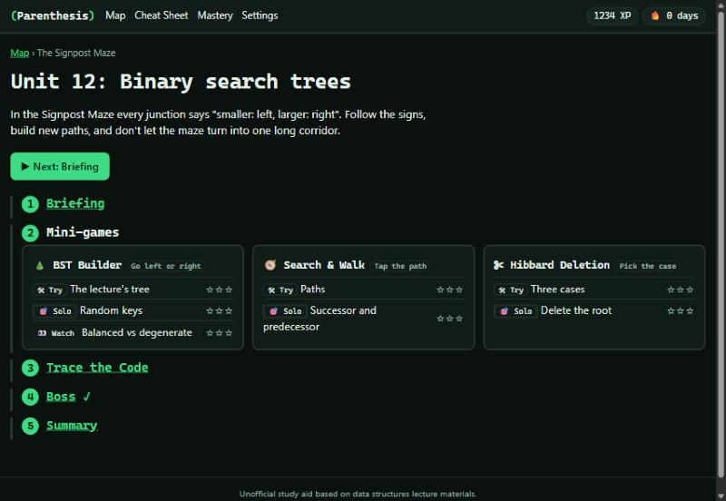

# Parenthesis

A browser game that teaches data structures by letting you *play* each algorithm.
Unofficial study aid based on data structures lecture materials.

**Play it online: https://parenthesis-labs.vercel.app/**



<table>
  <tr>
    <td width="50%"><br><sub><b>Build a BST</b>: pick left or right at each node. A wrong turn says why.</sub></td>
    <td width="50%"><br><sub><b>Pop a heap</b>: the same heap as a tree and as its array; tap the child to swap with.</sub></td>
  </tr>
  <tr>
    <td><br><sub><b>Watch two sorts race</b>: same input, live counters, the running Lisp line highlighted.</sub></td>
    <td>) returns; a wrong pick is explained"><br><sub><b>Trace the Code</b>: predict what the lecture's Lisp returns. Every answer is checked in SBCL.</sub></td>
  </tr>
  <tr>
    <td colspan="2"><br><sub><b>Each room</b>: a short briefing, mini-games (Watch, Try, Solo), Trace the Code, a Boss, and a summary.</sub></td>
  </tr>
</table>

## Play

Open `index.html` in any modern browser. No server, no build step, no network: it works offline from disk.

Fifteen lab rooms (Units 0–14) unlock in course order; the **placement quiz** skips ahead, and
**Settings → Unlock every room** opens everything for studying a specific lecture. Cross-unit modes:
**Review Room** (Leitner boxes of the concepts you slipped on), **Exam Mode** (timed random mix),
**Pick the Right Structure**, **Cheat Sheet** and **Mastery**.

| Unit | Room | Mini-games |
| --- | --- | --- |
| 0 Why data structures? | The Loading Dock | Right Tool, ADT or Not? |
| 1 Lisp bootcamp | The Paren Forge | Evaluator, Quote or Not? / Truthy or Falsy, Loop Tracer |
| 2 Big-O | The Growth Track | Growth Race, Simplify It, Big-O Detective, Count the Steps |
| 3 Arrays vs linked lists | The Pointer Workshop | Pointer Surgery, Shift Cost / Access Race, Cons Cell Builder |
| 4 Recursion | The Mirror Hall | Stack Tower, Tail or Not?, Fib Explosion |
| 5 Searching and sorting | The Archive | Library Detective, Sort Lab, Inversion Hunt, Balance-Scale Sort, Stable or Not? |
| 6 Quicksort | The Partition Floor | Partition Dance, Pivot Picker, Sorted-Input Trap |
| 7 Merge sort | The Conveyor Room | Merge Conveyor, Split and Merge Tree, Threshold Slider |
| 8 Stacks, queues, sets | The Loading Bay | Bracket Bouncer, Ring Road (+ two-stack deque), Monotonic Climb, Set Lab (+ A-list lookup) |
| 9 Hashing | Hash Hotel | Hash Hotel (+ cuckoo bonus), Tombstone Trap, Collision Lab |
| 10 Hash tables in Lisp | The Key Vault | Code Detective, The NIL Trap (+ EQL vs EQUAL), Resize Puzzle |
| 11 Trees | The Greenhouse | Traversal Trail, Terminology Tagging, Build the Parse Tree, Tree to Lists |
| 12 Binary search trees | The Signpost Maze | BST Builder, Search & Walk, Hibbard Deletion |
| 13 Splay trees | The Spinning Gallery | Rotation Lab, Splay It, Hot Keys |
| 14 Heaps and heapsort | The Triage Tower | Index Map, Swim Up, Sink Down, Heapify & Heapsort |

## Test

```
node tests/run-tests.js      # engines, referees, counters vs theory, content integrity, state layer
node tests/verify-lisp.js    # every printed Lisp result checked against SBCL, and against the game's
                             # own Lisp interpreter; Big-O step counts checked against SBCL
```

`verify-lisp.js` needs `sbcl` on your PATH (`node tests/verify-lisp.js 7` checks one unit).
`tests/browser-helpers.js` has console helpers for manual QA in a browser.

(For development previews, `.claude/launch.json` serves the folder on port 8306 with caching off.)

## Layout

| Folder | What lives there |
| --- | --- |
| `engine/` | Pure logic, no DOM. Step generators (`search`, `sorts`, `sorts2`), the referee, Big-O tools (`bigo`), a small Common Lisp interpreter (`lisp`), hashing, linked lists, stacks/queues/sets, trees, and the structure cost model (`choose`). |
| `ui/` | Reusable components: array, tree, stack, hash-table, cons-cell and list views, Lisp code panel, stepper, chart, counters, feedback, quiz, decision runner, watcher. `ui/games/` has one file per unit family of mini-games. |
| `content/` | Data only: one `unitN.js` per unit (briefing, levels, questions, explanations, Lisp snippets, concept cards). |
| `state/` | Progress, XP, streak, mastery, Leitner boxes, adaptive tiers, placement, settings in `localStorage` (try/catch: still works if storage is blocked). |
| `lisp/` | The canonical Lisp each unit shows; code panels are checked against it. |
| `tests/` | Plain Node test scripts. |

## Adding a unit

1. `content/unitN.js` registers `CQ.content.unitData[N]` (same shape as the others) and `content/units.js` lists it with `built: true`.
2. Engines go in `engine/`, game controllers in `ui/games/` (they register `CQ.games[id]`, plus any `CQ.games.briefingKinds` / `CQ.games.tasks` they need); add the `<script>` tags to `index.html`.
3. Put its Lisp in `lisp/unitN.lisp`; `tests/verify-lisp.js` and `tests/run-tests.js` pick new units up automatically.
